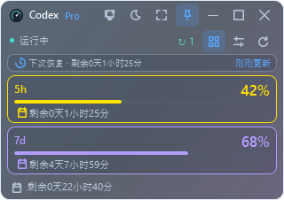
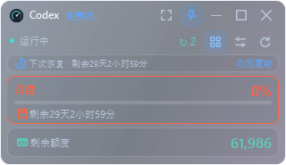

# Codex Quota Widget

Windows 桌面额度小组件，用紧凑的玻璃渐变界面显示当前 Codex 账号的剩余额度、重置时间、会员到期时间和可用重置次数。最新安装包见 [Releases](https://github.com/danterange/codex-quota-widget/releases/latest)，源码版本以 `CodexQuotaWidget.csproj` 为准。

## 界面截图





截图使用演示数据，不代表真实账号。界面会根据账号实际返回的额度窗口自动布局；例如账号只有 7 天额度时，5 小时额度行会自动隐藏。

## 功能

- 显示 5 小时和 7 天额度窗口、剩余百分比以及剩余时间；完成时间收在日历图标的悬浮提示中。
- 支持 ChatGPT Free：当 Codex 只返回 30 天/月度窗口时，显示月度剩余百分比和重置倒计时，不会误报“暂无额度数据”。
- 支持明确返回的“剩余额度”余额；余额与重置券数量独立展示，余额会随实际使用变化，不能与截图或历史值强行比对。
- 额度卡片上方显示最早恢复时间和上次成功更新时间；完整恢复时刻通过悬浮提示保留。
- 重置券仍以 `↻` 显示数量；悬浮提示会给出最早一张可用重置券的到期时间，不提供或调用重置操作。
- 会员/订阅区域只展示剩余天、小时、分钟，鼠标悬停后显示完整到期时间；可用重置次数显示在右侧徽标中。
- 额度颜色按已使用程度每 25% 切换为绿、紫、黄、红，颜色同时应用于标签、百分比、进度条和卡片边框；剩余 0% 显示红色。
- 只使用明确命名的会员到期字段；服务端未返回时，从本机 Codex 登录令牌的订阅声明补齐，不会把额度重置时间误当成会员到期时间。
- 使用本机 Codex app-server 的只读 JSON-RPC 请求读取数据，不修改账号、额度或登录状态。
- 每 10 秒自动刷新，刷新请求不会并行叠加；也可以在设置页选择 5、10、30、60 或 120 秒，或手动刷新。
- 支持简体中文和 English；语言、刷新间隔保存在当前 Windows 用户配置中。
- 支持夜间默认、白天和高透明玻璃三套主题；标题栏中的主题图标每次点击循环切换，当前主题和下一主题效果都写在悬浮提示中，并会保存到当前 Windows 用户配置。
- 默认宽度 320 像素，支持自由调整大小；自定义标题栏提供最小化、最大化/还原、置顶切换和关闭，默认置顶。关闭隐藏到托盘，完全退出使用托盘菜单。
- 标题栏从左到右提供“优雅重启 Codex Desktop”、主题、贴角、置顶、最小化、最大化/还原和关闭图标；所有图标及关键信息文字都有悬浮提示和辅助功能名称。
- 置顶按钮左侧提供“贴到最近角落”；按当前位置吸附到显示器工作区的左上、右上、左下或右下角，边缘保留 2 像素并避开任务栏，同时自动回到刚好容纳当前页面内容的紧凑尺寸。
- Windows 11 22H2 及以上支持 Acrylic 背景模糊与渐变；旧系统及高对比度环境回退到可读的不透明系统配色。
- 日期悬浮提示使用深色半透明高对比度样式，完整完成时间在浅色桌面上也清晰可读。
- 托盘菜单支持打开主界面和退出小组件，双击托盘图标也会打开主界面。
- 只在系统托盘保留图标，不占用任务栏；最小化或关闭后，从托盘菜单“主界面”或双击托盘图标恢复。
- 优先定位 Codex 桌面版自带的原生 `codex.exe`，兼容 `bin/<版本散列>/codex.exe` 路径；找不到时再尝试 PATH 中的 CLI。
- 登录、安装、网络和协议错误会转换为可操作的提示，并保留上一次成功的额度结果。
- 已有成功额度时，刷新中或首次失败都继续显示旧数据，并显示“正在获取最新数据…”；连续两次失败后才显示连接异常，避免临时网络波动覆盖有效结果。

## 数据来源与登录要求

默认模式会启动一个短生命周期的 Codex app-server 会话，依次发送 `initialize`、`account/read` 和 `account/rateLimits/read` 请求。真实模式要求本机已安装并登录 Codex 桌面应用或 CLI，并使用 ChatGPT 账号；API Key 登录不提供 Plus / Pro 订阅额度。

Free 的月度窗口来自明确返回的 `windowDurationMins=43200`；剩余额度只在 `credits.hasCredits=true` 且服务端返回余额时显示。程序不会推测套餐价格、不会把重置券数当余额，也不会调用重置、购买或套餐变更接口。

会员到期时间按以下顺序读取：

1. `account/read` 返回且名称明确表示会员或订阅到期的字段。
2. 本机 `CODEX_HOME/auth.json`（未设置时为用户目录下的 `.codex/auth.json`）中登录令牌的 `chatgpt_subscription_active_until` 声明。

令牌只在进程内解析，不写入日志、配置文件或界面。

## Codex Desktop 优雅重启

标题栏最左侧的循环箭头只针对 **ChatGPT Desktop / OpenAI.Codex MSIX**，不关闭、不重启也不恢复任何 `codex` CLI 会话。它会先检查精确的 MSIX 安装路径、当前 Desktop 根进程和仅含会话 UUID 的最小快照；任一安全条件不满足时会拒绝关闭现有 Desktop。

- 正常路径只发送 Desktop 的正常关闭请求；若超时，第一次点击不会强制结束进程，用户必须再次点击并在警告对话框明确确认，才会仅结束已捕获且精确匹配包路径的 Desktop 进程。
- 重新打开后会验证已有 ChatGPT 登录缓存。SSO、MFA、通行密钥或过期登录必须由用户完成，程序不会自动代填或绕过认证。
- 正在流式生成的桌面端会话没有可验证的公开“无缝续传”接口，因此恢复清单统一标记为需用户确认/手动继续；“Desktop 已重新打开”不代表原回合已自动恢复。
- 助手需要 PowerShell 7.4+（`pwsh.exe`）。它不读取或输出令牌、聊天正文、线程标题或 SQLite 内容；运行记录只留在当前用户的本地应用数据目录。

源码中的只读预检和安全模拟可用于诊断，不会关闭或启动 Desktop：

```powershell
pwsh -NoLogo -NoProfile -NonInteractive -File .\restart\Inspect-CodexDesktopRestart.ps1
pwsh -NoLogo -NoProfile -NonInteractive -File .\restart\Restart-CodexDesktop.ps1 -Mode Simulate -Execute
```

## 下载与安装

[下载最新版本](https://github.com/danterange/codex-quota-widget/releases/latest)

Windows 10/11 x64 用户下载 `*-setup.exe` 后双击安装；也可以下载 ZIP，解压后运行 `CodexQuotaWidget.exe`。安装包和 ZIP 都自带 .NET 8 运行时，不需要另外安装 SDK。安装器使用当前用户目录，不要求管理员权限。

安装包目前未签名，Windows 可能显示未知发布者或 SmartScreen 提示。升级前先从托盘退出小组件，再安装新版；当前没有程序内自动更新。

## 从源码运行

开发环境需要 Windows、.NET 8 SDK 和 WPF 桌面运行时：

```powershell
dotnet run --project .\CodexQuotaWidget.csproj
```

没有 Codex 登录状态时，可以用演示数据检查界面：

```powershell
dotnet run --project .\CodexQuotaWidget.csproj -- --demo
```

## 构建与验证

执行离线回归检查：

```powershell
dotnet build .\CodexQuotaWidget.csproj -c Release --no-restore
dotnet run --project .\tests\QuotaChecks\QuotaChecks.csproj -c Release
pwsh -NoLogo -NoProfile -NonInteractive -File .\restart\Restart-CodexDesktop.ps1 -Mode Simulate -Execute
```

在已安装并登录 Codex 的 Windows 环境中，可额外读取一次真实额度并验证定时刷新：

```powershell
dotnet .\tests\QuotaChecks\bin\Release\net8.0-windows\QuotaChecks.dll --live
```

构建自包含安装包、便携 ZIP 和 SHA-256 校验文件（需要 Inno Setup 6）：

```powershell
./scripts/Build-Release.ps1
```

版本发布流程见 [docs/RELEASING.md](docs/RELEASING.md)，发布操作约束见 [docs/发布新版本.md](docs/发布新版本.md)。

## 目录说明

- `MainWindow.xaml` / `MainWindow.xaml.cs`：主界面、设置页、托盘隐藏和窗口行为。
- `ViewModels/QuotaViewModel.cs`：自动刷新、倒计时、语言切换和错误状态。
- `Services/QuotaProvider.cs`：Codex app-server 通信、额度窗口解析和会员到期字段探测。
- `Services/CodexAuthMembershipReader.cs`：从本机登录令牌读取订阅到期时间。
- `Services/WidgetThemePalette.cs`：夜间、白天、玻璃和高对比度主题的动态语义色令牌。
- `Services/CodexDesktopRestartService.cs` 与 `restart/`：桌面端专用、可审计的重启监督器，不处理 CLI 会话。
- `Models/`：额度快照、用户设置和本地化文本模型。
- `tests/QuotaChecks/`：协议、登录令牌、设置和 WPF 刷新回归检查。

## 限制

- 目前仅提供 Windows x64 构建，不提供 ARM64 或 x86 专用包。
- 真实额度依赖本机 Codex 安装、ChatGPT 登录状态和网络连接。
- 会员到期字段受 Codex 服务端响应和本地登录令牌格式影响；两处都缺失时显示“会员到期时间未知”。
- 优雅重启只能验证并重新打开 ChatGPT Desktop；它不会自动恢复未完成的流式回合，也不会替用户完成需要交互的登录。

## 许可证

MIT License
